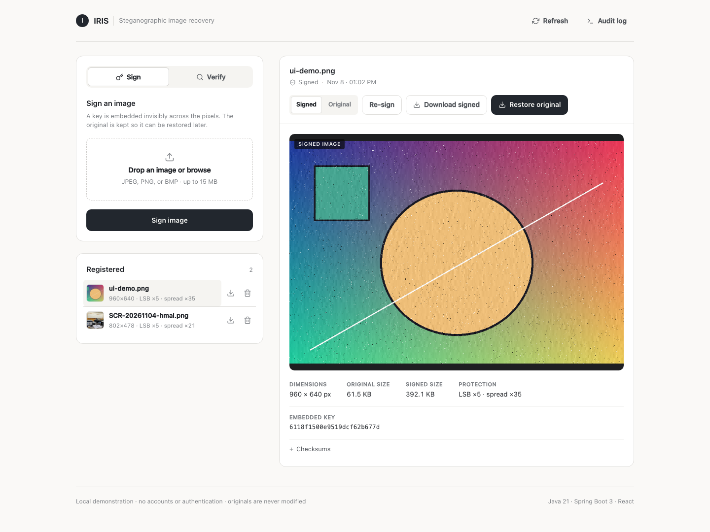
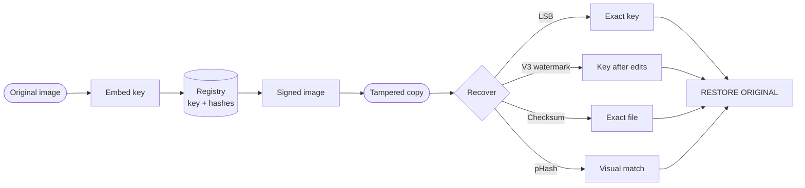

<div align="center">

# IRIS

**Image Recovery And Integrated Security**

An image carries its own registry key. Re-upload a tampered, cropped, or
re-compressed copy and IRIS finds the record, restores the exact original,
and shows what changed.


[Quick start](#quick-start) · [Deploy](#deploy-locally) · [How it works](#how-it-works) · [Benchmarks](#tests-and-benchmarks) · [API](#api) · [Design limits](#design-limits)

</div>



> **Local demonstration.** No accounts, passwords, or sessions. Anyone with
> network access can sign, verify, download, and delete images. Do not expose the
> service directly to the public internet.

---

## At a glance

| | |
|---|---|
| **Signing** | 96-bit key; **Invisible** (default, pixel-identical) or **Robust** protection |
| **Recovery** | LSB → V3 watermark → V2 / legacy V1 → SHA-256 → pHash |
| **Restoration** | Exact stored original plus a tamper report and difference map |
| **Quality** | 53 tests, including a 30 dB PSNR floor and a real-photo attack matrix |

---

## How it works



| Layer | Technique | Survives | Fails on |
|---|---|---|---|
| **LSB** | Key + CRC-32 in the low bit of every RGB channel, repeated at 5 spread offsets | Lossless re-saves, local edits outside the payload | JPEG, resizing, filters |
| **Robust V3** | Rate-1/2 convolutional encoding, soft Viterbi, whitened bits, repetitions on 8×8 and 16×16 grids, texture adaptation and edge erasures. Crop/scale search and reference-guided orientation correction | Real-photo edits: compression, resizing, cropping, blur, painting, cardinal and small rotations (measured limits in the benchmark) | Severe loss, some combined crop/resize/JPEG cases, perspective changes, transforms outside the bounded search |
| **pHash** | 64-bit perceptual hash in four cardinal orientations | Resize, 90° rotations, colour changes | Different images |

New V3 copies carry a 96-bit `SecureRandom` key plus a CRC-32 inside the
error-corrected payload; the key must exist in the registry. V2 copies and legacy
V1 copies (64-bit key + 32-bit HMAC) remain readable. Registry lookup identifies
a record; it is not a public-key ownership signature.

---

## Quick start

### 1. Prerequisites

| Tool | Version | Needed for |
|---|---|---|
| Git | any recent | cloning |
| JDK | **21 or newer** | backend |
| Node.js + npm | **20.19+ or 22.12+** | frontend (Vite 8) |
| Maven | not required | `./mvnw` is bundled |

<details>
<summary><strong>Install prerequisites</strong></summary>

**macOS**

```bash
brew install git node
brew install --cask temurin@21
```

**Ubuntu / Debian**

```bash
sudo apt update
sudo apt install -y git openjdk-21-jdk nodejs npm
```

If Node is older than 20.19:

```bash
curl -o- https://raw.githubusercontent.com/nvm-sh/nvm/v0.40.1/install.sh | bash
# restart the terminal, then:
nvm install 22
```

**Windows (PowerShell)**

```powershell
winget install Git.Git
winget install EclipseAdoptium.Temurin.21.JDK
winget install OpenJS.NodeJS.LTS
```

Verify:

```bash
java -version   # 21+
node -v         # v20.19+ or v22.12+
git --version
```

</details>

### 2. Clone, build, run

```bash
git clone https://github.com/notlikki/Iris.git
cd Iris

cd frontend && npm ci && npm run build
cd ../backend && ./mvnw spring-boot:run
```

Open **http://localhost:8080**. On Windows use `mvnw.cmd spring-boot:run`.

> **Repository access.** The clone commands assume the repository is public. If
> it is private, authenticate with Git or request access first.

### 3. Run the tests

```bash
cd backend
./mvnw test
```

Expected: **53 tests, 0 failures**.

---

## Deploy locally

**macOS / Linux**

```bash
git clone https://github.com/notlikki/Iris.git
cd Iris
(cd frontend && npm ci && npm run build)
(cd backend && ./mvnw spring-boot:run)
```

**Windows (PowerShell)**

```powershell
git clone https://github.com/notlikki/Iris.git
Set-Location Iris
Push-Location frontend; npm ci; npm run build; Pop-Location
Push-Location backend; .\mvnw.cmd spring-boot:run; Pop-Location
```

Open **http://localhost:8080**.

---

## Development mode

Two terminals for hot reload:

```bash
# terminal 1
cd backend && ./mvnw spring-boot:run
```

```bash
# terminal 2
cd frontend && npm ci && npm run dev
```

Open **http://localhost:5173**; Vite proxies `/api` to port 8080.

---

## Usage

**Sign** — choose an image, pick a **Protection** level, and press **Sign image**.

- **Invisible (default)** uses the LSB layer only. The signed file is visually identical to the original and verifies exactly when re-uploaded losslessly. Edited copies fall back to visual matching.
- **Robust** adds the V3 convolutional watermark. It survives compression, crops, and resizing, at the cost of a faint texture in smooth areas.

The signed copy, key, checksums, and protection layers appear on the right.

**Verify and recover** — switch to **Verify**, upload a tampered copy, and press
**Verify and recover**. Inspect the comparison slider and difference map, then
download the original.

**Upgrade an old copy** — select a V2/V3 record and press **Re-sign** to
regenerate its signed copy with V3; the 96-bit key and record stay the same.
Previously downloaded files do not change. Legacy V1 records cannot be silently
upgraded: re-sign returns an explicit message and the original must be registered
again to receive a new 96-bit key.

| Method | Meaning |
|---|---|
| `LSB` | Exact key from a lossless copy |
| `SPREAD` | Authenticated robust key recovered after edits |
| `CHECKSUM` | Exact original file |
| `PHASH` | Watermark unreadable; matched visually |
| `NONE` | No matching record |

```bash
curl -F "file=@photo.png" http://localhost:8080/api/records
curl -F "file=@tampered.jpg" http://localhost:8080/api/verify
```

---

## API

| Method | Endpoint | Description |
|---|---|---|
| `POST` | `/api/records` | Sign an image (`file`; optional `protection=invisible` (default) or `robust`) |
| `GET` | `/api/records` | List registered images, newest first |
| `GET` | `/api/records/{id}` | Record metadata and key info |
| `GET` | `/api/records/{id}/original` | Stream the untouched original |
| `GET` | `/api/records/{id}/signed` | Stream the signed image |
| `GET` | `/api/records/{id}/download` | Download the original as `restored_<name>` |
| `GET` | `/api/records/{id}/download-signed` | Download the signed image as `<name>_signed.png` |
| `POST` | `/api/records/{id}/resign` | Re-embed the original with the current watermark |
| `DELETE` | `/api/records/{id}` | Delete the record, files, and linked verifications |
| `POST` | `/api/verify` | Verify an upload and recover its record |
| `GET` | `/api/verifications/{id}/candidate` | Stream the uploaded candidate |
| `GET` | `/api/verifications/{id}/diff` | Stream the difference map |
| `GET` | `/api/audit-logs` | Recent sanitized audit events |

`POST /api/verify` returns the match method, record, perceptual distance,
similarity, changed-pixel metrics, difference map, and restore URLs.

---

## Configuration

| Property | Default | Env var | Description |
|---|---|---|---|
| `iris.storage.upload-dir` | `data/storage` | `IRIS_STORAGE_DIR` | Originals and verification artifacts |
| `iris.storage.max-width` | `4096` | — | Maximum width |
| `iris.storage.max-height` | `4096` | — | Maximum height |
| `iris.storage.max-pixels` | `16000000` | — | Maximum pixels |
| `iris.signing.secret` | dev value | `IRIS_SIGNING_SECRET` | Validates legacy V1 HMACs |
| `spring.datasource.url` | `jdbc:h2:file:./data/irisdb` | `IRIS_DB_PATH` | File-backed H2 database |
| `iris.frontend-dir` | `../frontend/dist` | `IRIS_FRONTEND_DIR` | Built frontend |
| `spring.servlet.multipart.max-file-size` | `15MB` | — | Upload limit |

```bash
export IRIS_SIGNING_SECRET="$(openssl rand -hex 32)"
export IRIS_DB_PATH="./data/irisdb"
export IRIS_STORAGE_DIR="./data/storage"
```

Records, verifications, and audit events persist in `backend/data/irisdb`.
Changing the signing secret stops legacy V1 MACs from validating; V2/V3 keys are
authenticated by registry lookup.

---

## Tests and benchmarks

- **52 automated tests**: error correction, independent watermark channels,
  real-photo edits, reference alignment, legacy compatibility, storage, and API
  behavior.
- Attack coverage: JPEG 0.10/0.05, quarter-size downscaling, 3×3 blur, 40%
  crops, crop → resize → JPEG, format conversion, and a 30 dB PSNR floor.
- Offline benchmark: V3 versus a frozen pre-upgrade baseline across six real
  images and two generated fixtures, ten conditions per fixture, plus two
  negative checks. It reports actual key recovery, not perceptual matching.
  Results and regressions live in
  [the benchmark report](backend/docs/watermark-benchmark.md) and
  [quality chart](backend/docs/watermark-quality.png).

<details>
<summary><strong>Reproduce the benchmark</strong></summary>

Fixtures are bundled under `backend/src/test/resources/watermark` with attribution
and checksums; tests do not download data.

```bash
cd backend
./mvnw test
java -Djava.awt.headless=true -cp target/classes:target/test-classes \
  com.iris.WatermarkBenchmark target/watermark-benchmark.csv
```

V2 uses the frozen pre-upgrade geometry search; V3 adds the new alignment and
error-corrected channels. Timing is local and single-run, not a production load
test. The screenshot fixture uses the platform monospace font, so its exact
pixels can vary across systems.

</details>

---

## Project layout

<details>
<summary><strong>Show structure</strong></summary>

```text
Iris/
├── backend/
│   ├── mvnw, mvnw.cmd          Maven wrapper
│   ├── docs/                   benchmark report + quality chart
│   └── src/
│       ├── main/java/com/iris/
│       │   ├── stego/          V3/V2/V1 encoders, convolutional code,
│       │   │                    alignment, pHash, recovery, crypto
│       │   ├── controller/     record + verification endpoints
│       │   ├── service/        records, verification, storage, audit
│       │   ├── model/          JPA entities
│       │   ├── repository/     Spring Data JPA
│       │   ├── dto/            API contracts
│       │   └── config/         storage, CORS, security headers
│       └── test/java/com/iris/ 53 tests + benchmark harness
└── frontend/
    └── src/
        ├── App.tsx             sign/verify dashboard
        ├── components/         upload, records, viewers, compare slider
        └── types.ts
```

</details>

---

## Troubleshooting

<details>
<summary><strong>Common issues</strong></summary>

| Problem | Fix |
|---|---|
| Java below 21 | Install JDK 21+ and set `JAVA_HOME` |
| Node version error | `nvm install 22` or install Node 20.19+ |
| `./mvnw: Permission denied` | `chmod +x mvnw` |
| Port 8080 busy | `lsof -i :8080`, kill the PID, or add `-Dspring-boot.run.arguments=--server.port=8081` |
| Blank page at 8080 | Run `cd frontend && npm run build` first |
| `npm ci` fails | `rm -rf node_modules && npm ci` |
| H2 database locked | Only one backend can use the file DB |
| Clone returns 404/403 | The repository is private; request access or make it public |
| First run is slow | `./mvnw` downloads Maven and dependencies |

</details>

---

## Design limits

### What the system guarantees

- A recovered watermark is accepted only when its key exists in the registry;
  legacy V1 copies also validate their HMAC. A perceptual match is never promoted
  to an authenticated match.
- Exact originals are matched by SHA-256 checksum before any approximate fallback.
- V2/V3 records can be upgraded with **Re-sign** while preserving their 96-bit
  key. V1 remains verifiable but must be registered again for a new key.
- 53 tests enforce the recovery matrix, independent channels, reference
  alignment, legacy compatibility, and the 30 dB PSNR floor.

### Inherent limits

- No invisible watermark survives arbitrary editing. Extreme downsampling, heavy
  blur, or repainting can destroy the signal; visual matching is approximate.
- Reference alignment estimates cardinal orientation, mirroring, and a small
  rotation (±12° coarse scan with bounded refinement) using up to two nearby
  stored originals. It guides correction only; decoding and registry lookup must
  still succeed. Perspective and arbitrary crop registration are not implemented.
- Geometry recovery is finite: registered dimensions × crop fractions (1, 7/8,
  3/4, 5/8, 1/2, 3/8, 1/4), then common inverse scales, capped at 48 attempts and
  160M normalized pixels.
- V3 uses a terminated constraint-length-7 convolutional code with generators
  (171, 133) in octal, soft Viterbi decoding, and CRC-32. Neither it nor the
  legacy CRC-syndrome repair guarantees recovery after arbitrary corruption.
- LSB survives lossless formats only; lossy re-saves rely on the robust layer.
- Recovery restores stored bytes; it does not regenerate pixels never stored.
- **Invisible** signing is LSB-only and pixel-identical; lossy edits drop the key
  and rely on visual matching. **Robust** signing survives edits at the cost of a
  faint texture. The choice is per record.
- Robust mode is invisible in practice, though very smooth areas can show faint
  texture under close inspection.

---

## Security notes

- Uploads are validated by magic bytes and decoded headers.
- Filenames never become filesystem paths; UUID keys and normalized path checks
  prevent traversal.
- SHA-256 is stored for originals and signed files.
- Errors are sanitized; stack traces, SQL, and storage paths are never returned.
- `nosniff`, `DENY`, `Referrer-Policy`, and `Cache-Control` headers are set on
  every response.
- The audit log records operations without file contents or storage paths.
